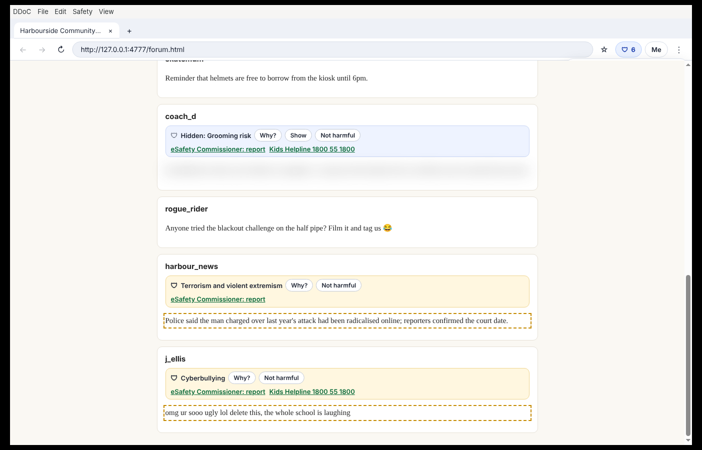

# DDoC Browser: Digital Duty of Care Browser

A privacy-first, open-source browser that puts online safety in the user's hands. It implements the user-side objectives of Australia's **Online Safety Amendment (Digital Duty of Care) Bill 2026** with personal, explainable AI filtering powered by **JEV** (TypeSafe AI) plus on-device learning.

Your filters change only what *you* see. Nothing is shared, host block lists are empty until you add one, and every decision is explained and reversible. Ads are the one filter that starts on: JEV hides a block when it judges the block itself to be an ad.



## What's here

| Part | Path | Status |
|---|---|---|
| Shared safety engine (taxonomy, JEV client, on-device learning, policy, profiles, encryption, RPC) | `packages/core` | Built and tested |
| Shared in-page agent (block detection, blur/label/hide/support screens, teach-by-selection, feed controls, scam-link guard) | `packages/page-agent` | Built, running in desktop |
| **Desktop browser** for Windows, macOS, Linux (Electron / Chromium): tabs, bookmarks, history, downloads, private windows, Safety Dashboard, app logo | `apps/desktop` | **Runs** |
| **Android** app (Kotlin, WebView + androidx.webkit, Keystore-encrypted state) | `apps/android` | Source complete; build with Android SDK |
| **iOS** app (SwiftUI, WKWebView with an isolated content world, Keychain + CryptoKit) | `apps/ios` | Source complete; build with Xcode on macOS |
| Legislative mapping, architecture, privacy, risk assessment, roadmap | `docs/` | Done |
| Evaluation set and harness (recall + over-blocking of protected expression) | `eval/`, `scripts/eval.ts` | Done |

## Quick start (desktop)

```bash
npm install
npm run build
npm test
npm start                      # launches DDoC Browser
```

JEV: set your TypeSafe key in **Safety Dashboard > Privacy & JEV**, or copy `.env.example` to `.env` and fill in `TYPESAFE_API_KEY`. The desktop app loads that file and `apps/desktop/.env` (the desktop file wins). `scripts/eval.ts` loads the repo-root file. A shell export wins over either file. Without a key, harm checks stay on-device and the ads filter does nothing until JEV is configured. Android and iOS do not read `.env`; their `.env.example` files say to set the key in the dashboard. Profiles saved before the ads filter existed pick it up the next time the engine starts.

Demo with the bundled test forum and a *mock* JEV server (heuristic stand-in, for offline demos only):

```bash
node --experimental-strip-types scripts/mock-jev.ts &
DDOC_DEMO=1 TYPESAFE_API_KEY=mock TYPESAFE_BASE_URL=http://127.0.0.1:4778 npm --workspace apps/desktop start
```

Packaging: `npm --workspace apps/desktop run dist:win | dist:mac | dist:linux` (needs `electron-builder`; macOS builds need signing and notarisation).

## Mobile

`npm run build` copies the shared engine, agent and dashboard into both mobile projects.

* **Android**: open `apps/android` in Android Studio (or `gradle assembleDebug` with SDK 35). Uses `addDocumentStartJavaScript` to inject the agent into every frame and `addWebMessageListener` so the page origin comes from WebView, not the page.
* **iOS**: `cd apps/ios && xcodegen && open DDoCBrowser.xcodeproj`. Apple requires WebKit for browsers in Australia, so iOS uses WKWebView; the agent runs in its own `WKContentWorld`, invisible to page scripts. The default-browser entitlement must be requested from Apple.

## How filtering works

1. **On-device**: your taught examples (similarity matching across all sites), plus high-precision safety rules. Always on, works offline.
2. **JEV**: undecided text is sent without URL or identity. In balanced mode that is only text with a risk signal, text that looks like an ad, or a block marked as an ad slot. One call asks which harm (if any), the communicative context (news, education, satire, political expression, support...), severity, and your custom categories. Ads are a separate yes/no question, not one of the harm choices. Ad-like text that is not otherwise risky is sent with only that question.
3. **Your categories**: create one under **Teach & learned**. It shows in the list there and is selected for the next example. The description is the question JEV is asked. Add an example if you also want an on-device match.
4. **Policy**: your profile, sensitivity and the context decide: allow, label, blur, hide, support screen, or block page. Protected expression is labelled, not hidden. An ad is hidden even when the surrounding page reads as news or opinion, because the question is whether that block itself is an ad.
5. **Explain and correct**: every item has *Why?*, *Show* and *Not harmful*. Corrections become negative examples. Adding or deleting a category or example reloads open web pages so the change applies immediately.

## Evaluation

```bash
node --experimental-strip-types scripts/eval.ts --local           # on-device stages only
TYPESAFE_API_KEY=... node --experimental-strip-types scripts/eval.ts   # real JEV accuracy
```

On the bundled 30-item set, on-device only: 75% recall on harmful items, 0% over-blocking of protected or benign items. Real-JEV numbers need your API key; the mock-server run only checks the plumbing and is not an accuracy result. The set is small and is a starting point, not a benchmark.

## Honest limits

See `docs/LEGISLATIVE_MAPPING.md` section 4. In short: a browser cannot change platform ranking, remove content for others, see inside native apps or E2EE chats, do licensed CSAM hash matching, or file the provider-side reports the Bill requires. The desktop shell uses Electron for now; the roadmap moves it to a patched Chromium build for faster security updates.

## Licence

MIT. See `LICENSE`.
